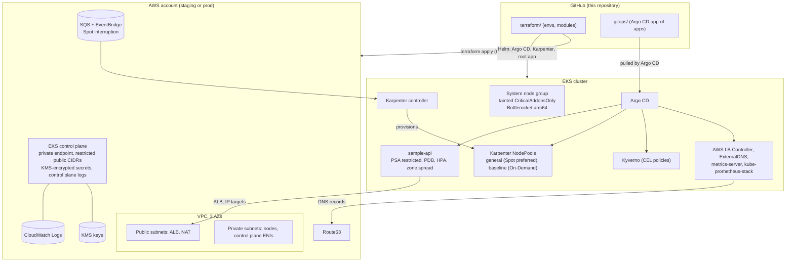

# aws-eks-platform

A production-shaped EKS platform on AWS: Terraform for the cloud layer, Argo CD for everything
inside the cluster, Karpenter for capacity, and policy and SLOs wired in from the start.

It is built as a reference for how I run Kubernetes platforms for teams that have to ship
safely and stay within budget. The organisation is fictional (`acme`, domain `acme-demo.dev`),
and every account ID in the repository is a placeholder.

## Problem

Teams that run Kubernetes on AWS usually end up with the same set of problems:

- Cluster access managed through `aws-auth` edits, nobody sure who has admin.
- Node groups per instance family, idle capacity, and slow scale-up.
- Workloads that run as root, with no requests, and no probes.
- Manual `kubectl apply` drift that nobody notices until the next incident.
- Upgrades that are scary because nothing is rehearsed and nodes are patched in place.
- Alerts on CPU instead of on the user experience.

This repository addresses each of these with a specific, reviewable design. The reasoning is in
[`docs/adr/`](docs/adr/) and the operational procedures are in [`docs/runbooks/`](docs/runbooks/).

## Architecture



More detail, including network and GitOps sequence diagrams, is in [`docs/architecture.md`](docs/architecture.md).

## Key features and design rationale

**Private cluster with a locked-down public endpoint.** Nodes and controllers use the private
endpoint. The public endpoint stays on for CI and operator access but only for listed CIDRs.
Variable validation rejects `0.0.0.0/0`, so the rule cannot be changed by accident.

**Access entries, not `aws-auth`.** Cluster access is granted through EKS access entries backed by
AWS managed policies: platform admins, the CI Terraform role, and a read-only auditor role. Every grant
is an IAM object that shows up in CloudTrail.

**Envelope encryption and audit logs.** Kubernetes Secrets are encrypted with a customer managed KMS key
with rotation. Control plane logs (`api`, `audit`, `authenticator`, `controllerManager`, `scheduler`)
and VPC flow logs go to CloudWatch with a KMS key of their own, retained for 365 days.

**Managed node group only for critical addons.** The system node group carries the taint
`CriticalAddonsOnly`. Only CoreDNS, the Karpenter controller and platform controllers tolerate it.
Application pods can never starve the components that schedule them.

**Karpenter for capacity.** Two NodePools express the capacity policy:

- `general` prefers Spot and falls back to On-Demand. Workloads that accept interruption opt in.
- `baseline` is On-Demand only, for workloads that must not be reclaimed.

Consolidation removes underused nodes. Disruption budgets cap how many nodes move at once, and prod blocks
voluntary disruption during weekday US Eastern business hours. Spot interruptions and rebalance recommendations
drain nodes ahead of time through an SQS queue fed by EventBridge.

**VPC CNI with prefix delegation.** Each node gets `/28` blocks of IP addresses, which removes the
classic per-ENI pod density ceiling. The `/20` private subnets leave room for growth.

**EKS Pod Identity, one role per controller.** The load balancer controller, ExternalDNS, EBS CSI and
Karpenter each get a role with only the policy they need, bound to exactly one service account. The ExternalDNS
role is scoped to the hosted zones it manages. No node role carries workload permissions. See
[ADR-0002](docs/adr/0002-pod-identity-over-irsa.md).

**Bottlerocket nodes, IMDS hop limit 1.** Nodes run an immutable OS with no SSH. Metadata requires IMDSv2 with a hop
limit of 1, so a pod cannot read the node role's credentials. Nodes are replaced rather than patched, which is
enforced by `expireAfter` and drift handling. See [ADR-0004](docs/adr/0004-bottlerocket-nodes.md).

**Argo CD app-of-apps.** Terraform installs Argo CD and one root application. Everything else is pulled from git
in sync waves: CRDs and controllers first, then policies and NodePools, then workloads. Self-heal reverts manual
edits. CI never holds cluster credentials. See [ADR-0003](docs/adr/0003-argocd-app-of-apps.md).

**Policy as code that actually runs.** Five CEL `ValidatingPolicy` objects enforce resource requests and memory
limits, pinned images (no `latest`), readiness and liveness probes, non-root, and no privileged containers or host
namespaces. Kyverno 1.20 no longer executes legacy `ClusterPolicy` objects, so the policies were migrated. CI proves
they bite: a deliberately non-compliant Deployment fails all five. See [ADR-0005](docs/adr/0005-kyverno-cel-validating-policies.md).

**Workload hygiene for sample-api.** Pod Security Admission `restricted` is enforced on the namespace. The Deployment
has probes (startup, readiness, liveness), requests and limits, a `preStop` drain delay for ALB deregistration,
`readOnlyRootFilesystem`, dropped capabilities, zone spread that is hard in prod, a PodDisruptionBudget, and an HPA
with asymmetric scaling (fast up, slow down).

**SLOs and multi-window burn-rate alerts.** The sample API has an availability SLO (99.9%) and a latency SLO (99% under
300 ms). Burn-rate alerts use the multi-window method from the Google SRE Workbook, so a page fires on a fast,
real burn and clears quickly after recovery. The error budget policy is written down in [`docs/slo.md`](docs/slo.md).

**Same code, two environments.** The staging and prod roots are identical. The only differences are `terraform.tfvars`,
`backend.hcl`, and the per-cluster GitOps directories. Promotion is a reviewed change, not a copy.

## Repository layout

```
.
├── .github/
│   ├── workflows/
│   │   ├── terraform.yml          # calls the shared aws-iac-foundations Terraform workflow (staging, then prod)
│   │   └── gitops.yml             # render, kubeconform, Kyverno, yamllint; no AWS access
│   ├── dependabot.yml
│   └── pull_request_template.md
├── terraform/
│   ├── modules/
│   │   ├── log-encryption-key/    # KMS key for CloudWatch Logs
│   │   ├── network/               # VPC (terraform-aws-modules/vpc), flow logs, S3 gateway endpoint
│   │   ├── eks-cluster/           # EKS (terraform-aws-modules/eks), access entries, addons, system node group
│   │   ├── karpenter/             # Karpenter IAM, queue, rules (eks//modules/karpenter) and Helm releases
│   │   ├── platform-identities/   # Pod Identity roles for LB controller, ExternalDNS, EBS CSI
│   │   ├── gitops-bootstrap/      # Argo CD Helm release and the root Application
│   │   └── platform/              # composition of the above, one per environment
│   └── envs/
│       ├── staging/               # thin root: versions, providers, tfvars, backend.hcl
│       └── prod/
├── gitops/
│   ├── bootstrap/root-app.yaml    # reference root Application (manual / disaster recovery)
│   ├── clusters/{staging,prod}/   # Argo CD Applications and AppProject, per cluster
│   ├── platform/
│   │   ├── karpenter/{base,overlays/{staging,prod}}   # NodePools, EC2NodeClass (Bottlerocket)
│   │   ├── monitoring/            # PrometheusRule: SLO recording and burn-rate alerts
│   │   └── storage/               # encrypted gp3 StorageClass
│   ├── policies/                  # Kyverno ValidatingPolicy objects (CEL)
│   └── apps/sample-api/{base,overlays/{staging,prod}}  # Kustomize workload
├── docs/
│   ├── architecture.md
│   ├── slo.md
│   ├── adr/                       # MADR decision records
│   └── runbooks/                  # symptoms, triage, mitigation, root cause, prevention
├── scripts/validate-gitops.sh     # the GitOps checks, identical locally and in CI
├── .checkov.yaml  .tflint.hcl  .yamllint.yaml  .pre-commit-config.yaml  .editorconfig
├── Makefile
├── CODEOWNERS  LICENSE
└── README.md
```

## How to deploy

### 0. Prerequisites

- An AWS account per environment. The `aws-iac-foundations` bootstrap stack is expected to provide the S3 state
  bucket (versioned, encrypted, public access blocked), the GitHub OIDC provider, and the Terraform CI role for each account.
- Repository variables `AWS_ROLE_ARN_STAGING` and `AWS_ROLE_ARN_PROD` for the reusable workflow.
- Tools for local work: Terraform 1.10+, `kubectl`, `helm`, `argocd` (optional), `kustomize`, `kyverno`,
  `kubeconform`, `tflint`, `checkov`, `yamllint`, `actionlint`. `make help` lists the local targets.

### 1. Fill in the environment

In `terraform/envs/<env>/terraform.tfvars`, replace the placeholders:

- `public_access_cidrs`: the CI runner egress range and the operator VPN CIDR. Never `0.0.0.0/0`.
- `platform_admin_role_arn`, `terraform_role_arn`, `auditor_role_arn`: the IAM roles for the account.
- `hosted_zone_arns`: the Route53 zones ExternalDNS may manage.

In `backend.hcl`, point `bucket` at the state bucket created by the bootstrap stack.

### 2. Apply Terraform

```bash
cd terraform/envs/staging
terraform init -backend-config=backend.hcl
terraform plan -out=tfplan
terraform apply tfplan
```

In practice the pull request gets a plan from `terraform.yml`, and merging to `main` applies staging, then prod.

The apply installs Argo CD, Karpenter, and the root Application.

### 3. Wire the outputs into GitOps

Two values come from Terraform and are not secret:

```bash
terraform output -raw vpc_id                    # -> vpcId in gitops/clusters/<env>/aws-load-balancer-controller.yaml
terraform output -raw karpenter_node_role_name  # must match the role in gitops/platform/karpenter/overlays/<env>
```

Commit the VPC ID, open a PR, and merge. The overlay values default to the `<cluster>-karpenter-node` role name that the
module creates. Check it matches the output before merging.

### 4. Provide the Grafana admin secret

The `grafana-admin` Secret (keys `admin-user`, `admin-password`) is managed out of band. It is never committed.
Create it in the `monitoring` namespace before Argo CD syncs the Prometheus stack, or Grafana will not start.

### 5. Let Argo CD sync

```bash
kubectl -n argocd get applications
argocd app wait root --sync --health --timeout 900   # or watch the Argo CD UI
```

Waves run in order: AppProject, platform controllers, policies and NodePools, SLO rules, sample-api.

### 6. Repeat for prod

Prod uses `per_az` NAT, on-demand baseline capacity, HA Argo CD, and deletion protection. Promote the same commit
after staging has been healthy for at least one business day.

## Local checks

Everything CI runs is available locally, and none of it touches AWS:

```bash
make check      # fmt, validate (both envs), tflint, checkov, GitOps validation
make gitops     # kustomize render, kubeconform strict with CRD catalog, Kyverno policies, yamllint
make lock       # regenerate .terraform.lock.hcl for linux_amd64 and darwin_arm64
```

## Upgrade strategy

Each change is one of four kinds, and each has its own path:

| Change | How | Risk control |
|---|---|---|
| Platform chart or controller version | Bump `targetRevision` in `gitops/clusters/<env>`. Dependabot proposes bumps for Terraform modules and GitHub Actions. | Staging first. Argo CD diff shows the change before sync. |
| Terraform module or provider | Dependabot PR, reviewed plan from CI. | Plan must show no unexpected replacement. |
| Kubernetes minor version | Staging `kubernetes_version`, then prod. Blue/green node groups and NodePools. Full procedure in [`docs/runbooks/eks-version-upgrade.md`](docs/runbooks/eks-version-upgrade.md). | Pre-flight deprecated API and addon checks. PDBs enforced during drain. |
| Node OS or AMI | Karpenter drift replacement (`bottlerocket@latest`), paced by disruption budgets. System group rolled by replacement. | `expireAfter` of 7 or 14 days, weekday block in prod. |

Kubernetes upgrades are one minor version at a time. The control plane is upgraded in place by AWS. Nodes are replaced,
never patched in place.

## Cost estimate

Rough monthly figures in USD, for `us-east-1`, from public on-demand list prices. These are planning numbers, not a quote.
They were not checked against the AWS Price List API, and they exclude Savings Plans, Spot price variance, and the
application's own cost. Data transfer depends heavily on traffic.

| Line item | Staging | Prod | Notes |
|---|---:|---:|---|
| EKS control plane | 73 | 73 | Per cluster |
| System node group | 120 | 180 | 2 vs 3 × m7g.large On-Demand |
| NAT gateways | 45 | 130 | 1 vs 3 gateways, plus data processing |
| ALB (sample-api) | 35 | 45 | Fixed hour plus LCUs |
| Karpenter capacity, general (Spot preferred) | 200 | 200 | 4 × m7g.xlarge Spot-equivalent, staging |
| Karpenter capacity, baseline (On-Demand) | 30 | 475 | Staging fallback vs 4 × m7g.xlarge On-Demand, prod |
| EBS (node data volumes, Prometheus) | 30 | 60 | gp3, encrypted |
| CloudWatch Logs, KMS, flow logs | 25 | 50 | Retention 365 days |
| Data transfer and miscellaneous | 20 | 50 | Varies with traffic |
| **Total (approximate)** | **~580** | **~1,260** | Range about ±25% |

Cost levers in this design: single NAT in staging, Spot preference in general capacity, consolidation, the S3 gateway
endpoint (keeps S3 traffic off NAT), and Bottlerocket's small OS volume. The largest unmanaged cost is Prometheus
retention and cardinality.

## Security posture

- **Network.** Private nodes, no public IPs, public API endpoint limited to listed CIDRs, explicit security groups, empty
  default security group, VPC flow logs.
- **Identity.** No `aws-auth`. Access entries for three roles. Pod Identity with one role per workload. No IRSA annotations.
  CI uses OIDC federation and holds no long-lived keys.
- **Data.** Secrets envelope-encrypted with KMS, rotation on. EBS and logs encrypted. State bucket with locking.
- **Nodes.** Bottlerocket, IMDSv2 with hop limit 1, no SSH, nodes replaced on a schedule.
- **Workloads.** Pod Security Admission `restricted` on the workload namespace. Kyverno policies for requests, pinned images,
  probes, non-root, privilege escalation and host namespaces. `automountServiceAccountToken: false`.
- **Supply chain.** Pinned chart versions in Argo CD, pinned Terraform providers and modules, provider lock files committed.
  Dependabot for Actions, Terraform and pre-commit. Checkov and tflint run in CI, and every skip carries a justification.
- **Secrets.** None in Git. Grafana admin credentials are created out of band. Pull credentials are not in the manifests.

## What I'd do next

1. **Pin the Bottlerocket release for prod.** Replace `bottlerocket@latest` with a reviewed release, and move AMI
   promotion into the same flow as chart promotion.
2. **Renovate for chart versions.** Dependabot does not update Helm charts referenced from Argo CD `Application`
   manifests. Renovate does, and it would close that gap.
3. **Narrow the AppProject.** `clusterResourceWhitelist` is `*` today, because platform charts install cluster-scoped
   objects. Enumerate the kinds per component.
4. **Secrets management.** External Secrets Operator with AWS Secrets Manager, so the Grafana and registry credentials are
   managed by the same workflow as everything else.
5. **Image supply chain.** Cosign signatures and Kyverno `ImageValidatingPolicy` to admit only signed images from the
   platform's registry.
6. **Deprecated API check in CI.** Run `pluto` against `gitops/` so EKS upgrades do not depend on pre-flight discipline.
7. **Metrics at scale.** Prometheus is single-replica with local storage. Next step is Amazon Managed Prometheus or Thanos,
   and remote-write for long-term SLO history.
8. **Private registry path.** Interface VPC endpoints for ECR, STS, and EC2 in prod, to remove NAT from the image pull path
   and reduce data processing cost.
9. **Human SSO for Argo CD.** Dex is disabled today. Wire OIDC through the identity provider, and map groups to Argo RBAC.
10. **Chaos and game days.** AWS Fault Injection Service experiments for Spot interruption, AZ loss and node failure,
    with results written back to the SLO review.

## Verification status

- Terraform: both environment roots pass `fmt`, `init -backend=false`, `validate`, `tflint` (terraform and AWS rulesets),
  and Checkov with zero failures. Provider lock files are generated for `linux_amd64` and `darwin_arm64`.
- GitOps: all overlays render, kubeconform strict validates every resource against the CRD catalog with no fallback
  skips, the Kyverno policies pass the rendered sample workload in both environments and fail a deliberately bad one,
  and yamllint passes.
- Workflows: `actionlint` passes.
- Not verified here: a live `terraform plan` or apply, and a live Argo CD sync. Both need AWS credentials and a cluster.
  The Helm charts were checked for availability and version, not rendered against the values in every Application.

## License

MIT. See [LICENSE](LICENSE). Copyright (c) 2026 Adrian Garcia.
