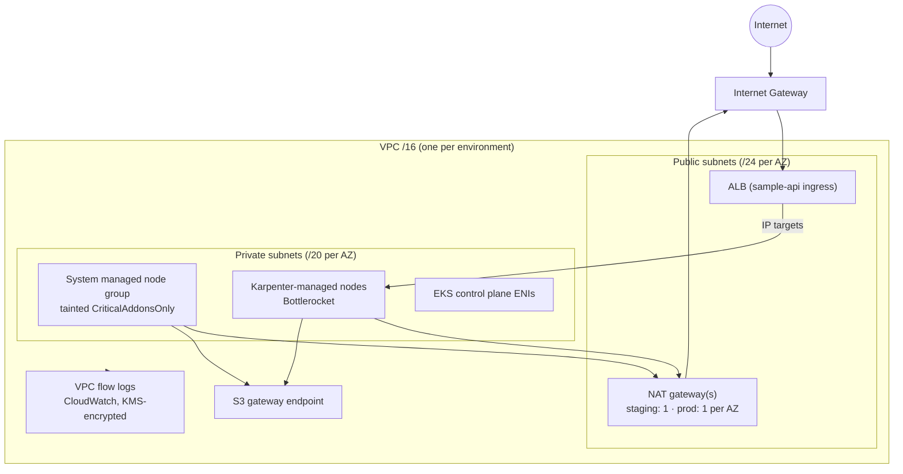
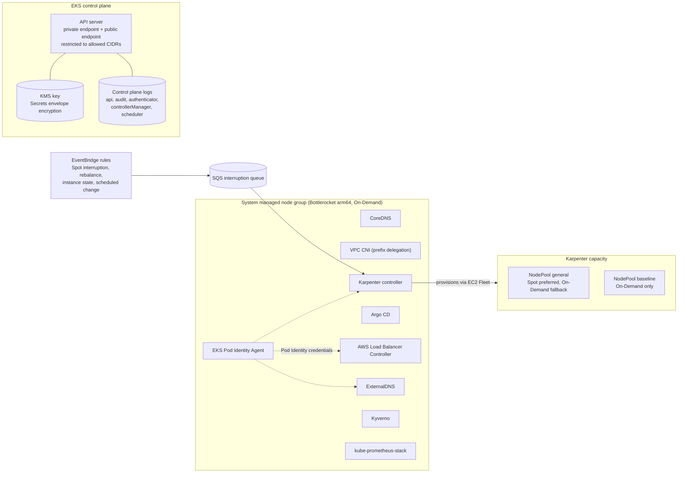
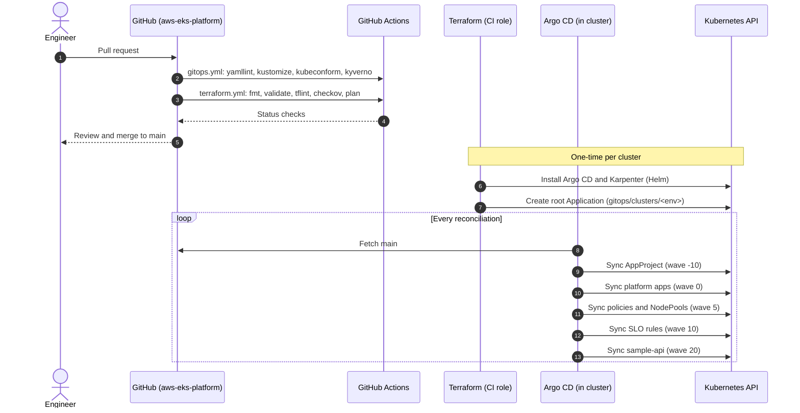
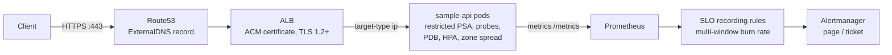

# Architecture

This document describes how the platform is laid out and why. Decisions with
trade-offs are recorded in [`adr/`](adr/); operational procedures are in
[`runbooks/`](runbooks/); service objectives are in [`slo.md`](slo.md).

## 1. Network

Each environment gets its own VPC. Three availability zones, a `/20` private
subnet per zone for nodes and pods (large enough for prefix-delegated VPC CNI),
and a `/24` public subnet per zone that holds only internet-facing load balancers
and NAT gateways.

Design points:

- Nodes never receive public IPs. Egress goes through NAT, and S3 traffic stays
  on the gateway endpoint so it bypasses NAT data charges.
- Default security group is emptied. Every security group is explicit.
- Subnets carry `karpenter.sh/discovery` and the `kubernetes.io/role/*-elb` tags,
  so Karpenter and the load balancer controller place resources without hard-coded IDs.

## 2. Cluster

Access control has no `aws-auth` ConfigMap. Humans, the CI Terraform role and an
auditor role are granted through EKS access entries backed by AWS managed access
policies. Workloads authenticate to AWS through EKS Pod Identity, one role per
controller, scoped to the minimum policy it needs.

## 3. GitOps flow

Terraform installs Argo CD and one root `Application`. Everything after that is
pulled from git. Nothing in the cluster is changed by a pipeline pushing manifests.

Sync waves order the platform so that CRDs (Kyverno, Prometheus Operator, Karpenter)
exist before the resources that depend on them.

## 4. Workload path

## 5. Environment differences

| Concern | Staging | Prod |
|---|---|---|
| NAT | single gateway | one gateway per AZ |
| General capacity | Spot preferred, On-Demand fallback | Spot opt-in only |
| Baseline capacity | small On-Demand fallback | On-Demand default landing pool |
| Karpenter replicas | 1 | 2 |
| Argo CD | single replica | HA (2 server, 2 repo-server) |
| Kyverno admission | 2 replicas | 3 replicas |
| Deletion protection | off | on |
| Disruption budgets | 20% | 10% plus no voluntary disruption on weekday US Eastern business hours |

The environment roots are identical. Only `terraform.tfvars`, `backend.hcl` and the
matching `gitops/clusters/<env>` and overlay directories differ.
